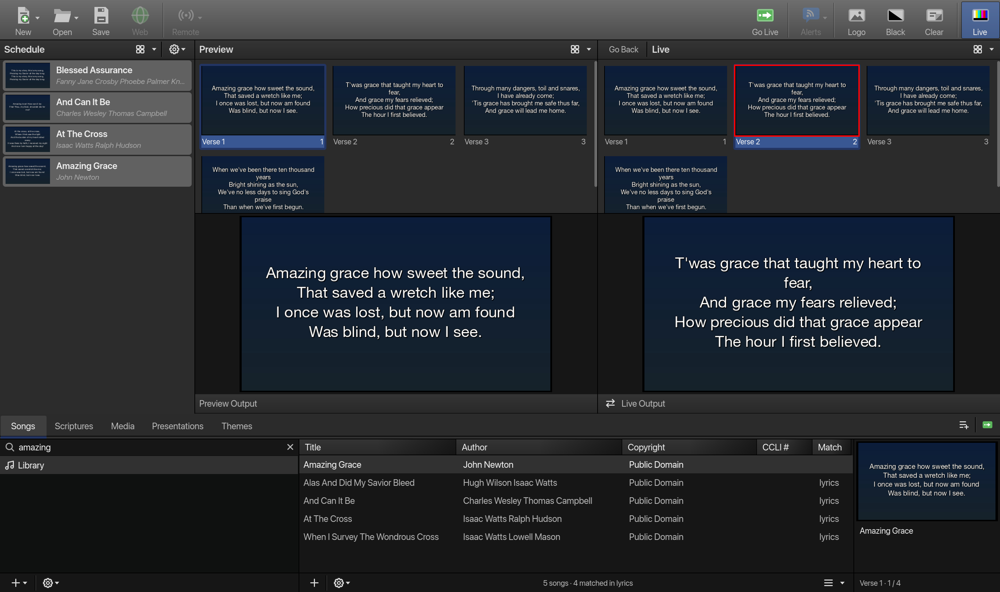

<p align="center">
  
</p>

# FreeBeams

FreeBeams is a free worship presentation app for churches: songs, scripture, media and slide decks on a
projector, run from an operator window laid out like EasyWorship. It is a native desktop app written in **Go**
on **Godot 4.7** through [graphics.gd](https://graphics.gd), with a pure-Go SQLite library. macOS is the primary
platform; Windows and Linux builds come from the same code.



## What it does

- **Songs**: a library with full-text search over titles, authors and lyrics, a lyric editor with section labels
  (Verse, Chorus, Bridge, Tag…), and slides built from the sections. EasyWorship 8 libraries import at first launch.
- **Scripture**: the King James Version and the American Standard Version ship inside the app. Your own Bible
  files import too (EasyWorship `.ewb`, JSON folders and single files, `en_kjv.json`-style arrays); copyrighted
  translations are never bundled, only imported from files you hold a licence for ([docs/BIBLES.md](docs/BIBLES.md)).
  Type a reference such as `jn 3:16-18` or `ps 23` and go live.
- **Media**: images, videos and audio with thumbnails, aspect-ratio and loop options per item, and native playback
  with sound on the projector (AVFoundation on macOS). A transport bar under each output monitor gives seek,
  pause, loop and volume ([docs/MEDIA.md](docs/MEDIA.md)).
- **Presentations**: PDF, PowerPoint and Keynote files become image slides you can step through.
- **Themes**: fonts, colours, outlines, shadows and backgrounds per song and per scripture, with a theme editor.
- **Output**: a borderless projector window on a second display (or windowed on one screen), Black, Clear and
  Logo screens, crossfade and other transitions. Hotkeys follow EasyWorship: arrows or Space for the next slide,
  Enter for Go Live, Page Up/Down to walk the schedule live, Ctrl+B Black, Ctrl+C Clear, Ctrl+L Logo, and
  `V`/`C`/`B`/`T` plus a number to jump to a section.
- **Schedules**: build the service from the library, reorder, save as `.fbs` files and reopen them.
- **Control API**: everything the UI can do is also an HTTP action with a bearer key, which is how the end-to-end
  tests drive the app.

The UI specification is [docs/UI-SPEC.md](docs/UI-SPEC.md); the plan and status are [PLAN.md](PLAN.md),
[docs/PHASE1-STATUS.md](docs/PHASE1-STATUS.md) and [docs/PHASE2-STATUS.md](docs/PHASE2-STATUS.md).

## Requirements

- **Go** at the version in `go.mod` (currently 1.27). The build tool `gd` is pinned there too and fetched by
  `bin/gd`; it downloads its own copy of Godot 4.7.2 into `~/gd/freeworship` on first use, so no Godot install is
  needed.
- **macOS 13 or later** for development and the macOS build (Xcode command line tools for cgo).
- Optional: **ffmpeg** on PATH for video thumbnails and transcodes; **LibreOffice** for PowerPoint and Keynote
  conversion (PDFs need nothing extra on macOS).

## Build and run from source

```bash
git clone git@github.com:Devsecway/freebeams.git
cd freebeams
go build ./... && go vet ./... && go test ./...   # unit tests, pure Go
bin/gd run                                        # builds the dylib and launches the app
```

The first `bin/gd run` downloads Godot and runs a headless import, then builds and starts the app. The library
lives in `~/Library/Application Support/FreeBeams/library.db` (on Windows `%AppData%\FreeBeams`, on Linux
`~/.config/FreeBeams`), caches in the OS cache directory under `FreeBeams`. `FREEBEAMS_LIBRARY=<path>` points the
app at another library; `FREEBEAMS_CONTROL_KEY` pins the control API key for scripts.

End-to-end tests launch the app and drive it through the control API, taking screenshots into `test/out/`:

```bash
test/smoke.sh        # about 4 minutes, 586 checks
test/splitters.sh    # drags every splitter through Godot's input pipeline
```

## Release builds

`graphics/project.godot` `config/version` is the single version source; `bin/version` prints it. Full details,
signing and CI are in [docs/RELEASE.md](docs/RELEASE.md).

| Platform | Command | Produces |
|---|---|---|
| macOS | `GOOS=macos bin/gd build`, then `bin/release-dmg` | `releases/darwin/universal/FreeBeams.app`, `releases/FreeBeams-<v>-macOS.dmg` |
| Windows | `bin/build-windows` (see below) | `releases/windows/amd64/`, `releases/FreeBeams-<v>-windows-amd64.zip`, `releases/FreeBeams-<v>-Setup.exe` |
| Linux | `bin/build-linux` | `releases/FreeBeams-<v>-linux-<arch>.tar.gz`, `releases/FreeBeams-<v>-<arch>.AppImage` |

Pushing a `v*` tag runs `.github/workflows/release.yml`, which builds all three natively and opens a draft
GitHub release with the artifacts and checksums.

### Building the Windows installer

The installer (`FreeBeams-<version>-Setup.exe`) is built **on Windows**. The build runs in an MSYS2 shell because
the Go side of the app is a C-shared DLL that MinGW gcc compiles; the installer itself comes from Inno Setup.

1. **Install the tools** (once), from an administrator PowerShell with [winget](https://learn.microsoft.com/windows/package-manager/):
   ```powershell
   winget install GoLang.Go
   winget install MSYS2.MSYS2
   winget install JRSoftware.InnoSetup
   winget install Git.Git
   ```
   Then open the **MSYS2 UCRT64** shell from the Start menu and install the compiler and zip:
   ```bash
   pacman -S --needed mingw-w64-ucrt-x86_64-gcc zip
   ```
   Go must be on the PATH inside that shell. If `go version` fails there, add it to `~/.bashrc`:
   `export PATH="$PATH:/c/Program Files/Go/bin"`.
2. **Get the source** in the UCRT64 shell:
   ```bash
   git clone git@github.com:Devsecway/freebeams.git
   cd freebeams
   ```
3. **Build**:
   ```bash
   bin/build-windows
   ```
   (From a plain Windows terminal the same thing is `MSYSTEM=UCRT64 C:\msys64\usr\bin\bash -l bin/build-windows`
   run from the repository folder.) The script:
   - runs `GOOS=windows bin/gd build`, which compiles `windows_amd64.dll` with gcc and exports the
     `Windows x86_64` preset with Godot (the first run downloads Godot and the Windows export template into
     `~/gd/freeworship` and `%AppData%\Godot\export_templates`);
   - copies the DLL next to `FreeBeams.exe` and bundles any MinGW runtime DLLs it still needs;
   - downloads `rcedit` into `~/.cache/freebeams/` and brands the exe with the icon and version resource;
   - zips the folder as `releases/FreeBeams-<v>-windows-amd64.zip`;
   - finds `ISCC.exe` (on PATH, or in `Program Files (x86)\Inno Setup 6`, `Program Files\Inno Setup 6` or the
     per-user `%LocalAppData%\Programs\Inno Setup 6`) and compiles `packaging/windows/freebeams.iss` into
     `releases/FreeBeams-<v>-Setup.exe`.
4. **Install it** by running the Setup. It installs per user by default (no admin rights needed, which suits church
   laptops), with Start menu and optional desktop shortcuts and an uninstaller; the same `AppId` lets a newer Setup
   upgrade in place. Windows SmartScreen warns about the unsigned file; set `SIGNTOOL_CMD="signtool sign /fd SHA256
   /tr <timestamp URL> /td SHA256 /a"` before the build to sign every exe and DLL with your own certificate.

Options: `NO_INSTALLER=1` builds only the zip; `GOARCH=arm64` builds for Windows on ARM. Cross-building the zip
from macOS or Linux works with `zig` on PATH (`gd` uses `zig cc`), but the exe is not branded and no installer is
produced; the installer always needs a Windows machine (or the release workflow's `windows-latest` runner).

## Project layout

```
main.go                 startup: register classes, add the App node
internal/models         domain types and logic (songs, scripture, slides, themes, schedule), pure Go
internal/store          SQLite persistence and FTS5 search
internal/importers      EasyWorship (lyrics RTF, .ewb Bibles, media), Bible JSON
internal/bibles/bundled the embedded KJV and ASV
internal/media          media scan, thumbnails, ffmpeg behind interfaces
internal/presentations  PDF / Office to image slides
internal/render         Godot: slide rendering, transitions, the output window, native video
internal/ui             Godot: the operator UI widgets (dumb views)
internal/control        the HTTP control server
internal/app            wires everything together
test/                   smoke.sh and splitters.sh end-to-end suites
packaging/, bin/        installers, icons and release scripts
docs/                   specs, status, formats, branding
```

Conventions for contributors (state machine UI, package dependency rules, Godot gotchas) are in
[CLAUDE.md](CLAUDE.md).

## Licensing

- The code has no licence file yet; until one is added it is all rights reserved by the authors.
- The bundled Bibles (KJV, ASV) are public domain. Other translations enter a library only through your own
  import, and you are responsible for holding a licence for them.
- The logo and wordmark are original work for this project ([docs/branding/README.md](docs/branding/README.md)).
  EasyWorship is a trademark of Softouch Development; FreeBeams is not affiliated with it.
