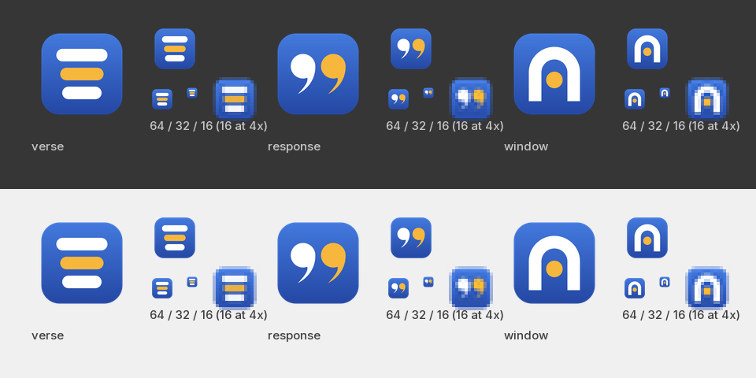
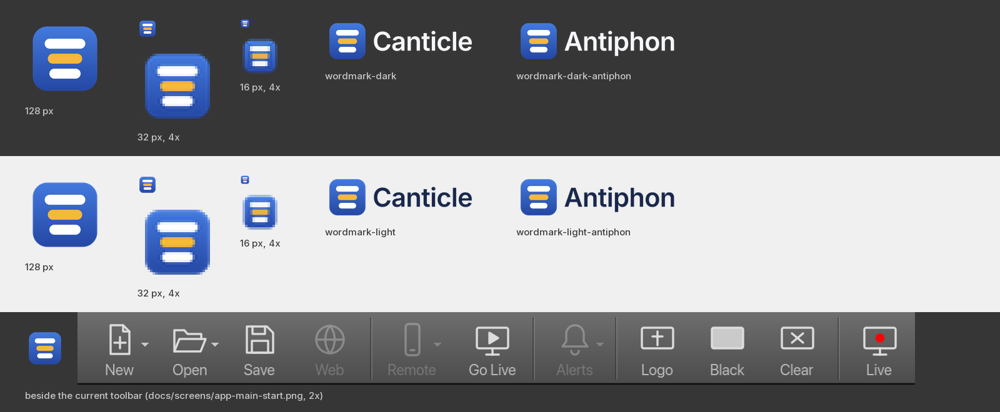
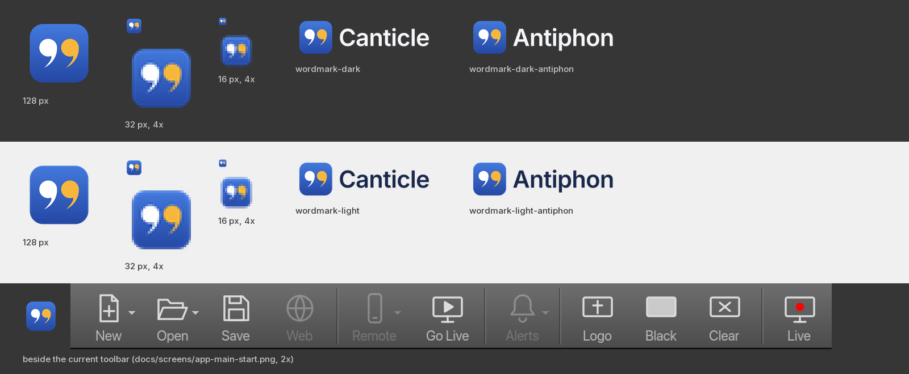
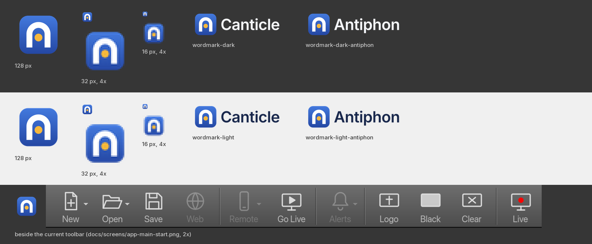

# Name and logo: decision pack

A proposal for a new name and a logo for the app currently called FreeWorship. Nothing in the code, the
docs, the bundle ids or the repo has been renamed; this directory only holds the material to decide with.

**Why rename at all.** "FreeWorship" is already a worship presentation app: a Windows program from a team in
Southampton (UK) that has been listed for years on [SourceForge](https://sourceforge.net/app/freeworship/),
[AlternativeTo](https://alternativeto.net/software/freeworship/about) and
[OSCAR](https://oscar.org.uk/resources/freeworship). Shipping under the same name in the same category would be
confusing for churches searching for either product and a weak position if the other project ever objected.

Open **`preview.html`** in a browser to compare the three logo concepts side by side at every size.

---

## 1. Name

### 1.1 Shortlist (ranked)

| # | Name | Meaning | Why it fits | Risks found | Schedule ext. | Bundle id |
|---|---|---|---|---|---|---|
| **1** | **Canticle** | A song of praise, usually a sung scripture text (the Magnificat, the Canticle of the Sun). | Says "sung words" in one everyday English word that churchgoers already know from hymnals; warm, pronounceable, spellable, easy to search for. | No worship software or software company found. A pending US mark **CANTICLESCRIPT** (music-composition software, lyric SaaS) is in the same class and worth monitoring. "Cantara" (an open-source song projector) shares the stem. `canticle.app/.com/.org/.io` are all registered. | `.canticle` | `com.devsecway.canticle` |
| **2** | **Antiphon** | A verse sung in response, by the people answering the leader. | The product in a word: the screen gives the line, the congregation sings it back. The cleanest name screened: no product, company or trademark hit. Identical word in German. | Less known outside liturgical traditions; the "anti-" start reads negative at a glance and invites the misspelling "antiphone". `antiphon.app/.com/.org/.io` registered (`.io` in Aug 2025). | `.antiphon` | `com.devsecway.antiphon` |
| 3 | Lectern | The stand from which the Word is read to the room. | Presentation-flavoured, dignified, a single plain word; the operator's desk is a lectern of sorts. | A church-adjacent collision: a WordPress sermon-publishing plugin is called Lectern. Several unrelated dev tools (Minecraft tooling, a data-dictionary tool). The word is opaque to non-English speakers (es *atril*, fr *lutrin*, de *Lesepult*). | `.lectern` | `com.devsecway.lectern` |
| 4 | Selah | The Psalms' pause mark ("stop and listen"), 71 times in the Psalter. | Instant resonance with the audience; short; feels like a worship brand. | Crowded: a Dove-award-winning vocal trio, a Bible app, a sermon-notes app, three live US software trademarks (SELAH DEVOS, SELAH CENTRAL, SELAH GLOBAL) and two small GitHub projects literally called `selah-worship` (one is a church projection system). Hard to own in search. | `.selah` | `com.devsecway.selah` |
| 5 | Nave | The body of the church where the congregation sits; from *navis*, ship. | Four letters, architectural, the Church-as-ship image; *nave* also means ship in Spanish, Portuguese and Italian. | Too short and generic to own: `isaacs/nave` (1.6k stars) is a well-known Node version manager; all domains taken; "knave" homophone. | `.nave` | `com.devsecway.nave` |

**Recommendation: Canticle.** Runner-up: **Antiphon**. Canticle wins on recognition (a church volunteer
knows the word), on sound and on the story it tells for an app whose job is to put sung words on a screen. Antiphon is
the cleaner mark legally and the better story for the call-and-response of a service, but it asks every new user to
learn a word and to spell it. Both are built into every logo file below.

The schedule extension today is `.fws` (`models.ScheduleFileExt`). A full-word extension (`service.canticle`) is
self-documenting and unique; macOS, Windows and Linux all accept it (EasyWorship itself uses `.ewsx`). If a short
one is preferred, `.cntl` is free of other meanings; `.cant` is not.

### 1.2 Screening evidence (top 8, searched 2026-10-19)

Web search, GitHub repository/name search (`gh search repos --match name`, `gh api users/<name>`), DNS (`host`,
`dig`, `whois`) for `.app/.org/.com/.io`. A resolving domain means someone holds it; nothing here is a trademark
clearance. Language notes are from general knowledge, not from native-speaker review.

- **Canticle.** No presentation software: searches return [Cantara](https://flathub.org/apps/app.cantara.Cantara),
  Praisenter and OpenLP instead. GitHub: [Comcast/Canticle](https://github.com/Comcast/Canticle) (50 stars, a Go
  dependency tool), [sydlexius/canticle](https://github.com/sydlexius/canticle) (lyrics fetcher), `canticleAPP`
  (lyrics directory); the user `canticle` exists with 0 repos. Trademark: pending US application
  [CANTICLESCRIPT, serial 99670170](https://trademarks.justia.com/996/70/canticlescript-99670170.html), filed
  2026-02-25, Class 9 music-composition software and Class 42 SaaS matching theological themes to song lyrics; a
  different mark, but same class and faith-music adjacent. Domains: `.com/.org/.io` resolve, `.app` is registered
  (Cloudflare nameservers, no site). Languages: es *cántico*, fr *cantique*, pt *cântico*, de *Canticum* (same
  meaning everywhere, no unfortunate homonyms).
- **Antiphon.** No software product, company or trademark found
  ([Wikipedia](https://en.wikipedia.org/wiki/Antiphon) and liturgical publishers only). GitHub:
  [chalkwalk/antiphon](https://github.com/chalkwalk/antiphon) (NINJAM audio plugin, 2 stars),
  [MaxCaspar/antiphon](https://github.com/MaxCaspar/antiphon) (2 stars), `ziglibs/antiphony` (Zig RPC); the user
  `antiphon` exists (38 repos). Domains: `.com/.org` resolve, `.app` registered (DreamHost), `.io` registered
  2025-08-27 (Squarespace), no site. Languages: es/pt *antífona*, fr *antienne*, de *Antiphon*.
- **Lectern.** No presentation software. [Lectern WordPress plugin](https://wordpress.org/plugins/lectern/) publishes
  sermons on church websites (church-adjacent). GitHub: [mcbeet/lectern](https://github.com/mcbeet/lectern)
  (Minecraft data packs, 22 stars), `Acumane/lectern` (PDF text-to-speech), `lectern-crash`; the user `lectern`
  exists. Domains all resolve.
- **Selah.** [Selah (group)](https://en.wikipedia.org/wiki/Selah_(group)), the Nashville vocal trio. Apps: a Bible
  study app ([toazd/selah](https://github.com/toazd/selah)), a sermon-notes app (studio hevv), a Framer church
  template. US marks: [SELAH DEVOS](https://trademark.justia.com/882/08/selah-88208636.html) (mobile app software,
  study content), [SELAH CENTRAL](https://trademarks.justia.com/868/03/selah-86803236.html) (legal SaaS),
  [SELAH GLOBAL](https://trademarks.justia.com/867/63/selah-86763967.html) (finance software). GitHub:
  [ThiagoAkatsuka/selah-worship](https://github.com/ThiagoAkatsuka/selah-worship) (PHP/Laravel church projection
  system), [juandozuna/selah-worship](https://github.com/juandozuna/selah-worship) (lyrics with NDI/Syphon for
  ProPresenter); the organisation `selah` exists. Domains all resolve. pt *sela* (saddle) is a harmless near-homophone.
- **Nave.** No church software. GitHub [isaacs/nave](https://github.com/isaacs/nave) (1,635 stars). Domains all
  resolve.
- **Lantern** (rejected). [getlantern/lantern](https://github.com/getlantern/lantern) (16k stars,
  [lantern.io](https://lantern.io), a VPN/circumvention tool) and `lanterndata/lantern` (Postgres extension): a
  major software brand collision.
- **Doxa** (rejected). Crowded in the Christian space: the [Doxa prayer app](https://faith.tools/app/doxa) (Doxa
  Inc., 2022, worship music and guided prayer), [Doxa Church apps](https://apps.apple.com/app/id951899618), Doxa Date;
  DOXA watches; GitHub `ribelo/doxa` (236 stars), `bcirilor/doxa-worship-platform`.
- **Vesper** (rejected). Multiple software trademarks ([Vesper Technologies LLC, AI app, pending](https://trademark.justia.com/owners/vesper-technologies-l-l-c-5495510);
  [VESPER SaaS, serial 98474866](https://trademarks.justia.com/984/74/vesper-98474866.html); a registered VESPER for
  reputation/cyber-security software), a commodity-intelligence startup, the [Vesper notes app](https://github.com/brentsimmons/Vesper),
  a VS Code theme (788 stars), an AI prayer app. de *Vesper* also means an evening snack.

### 1.3 The long list

Descriptive: OpenWorship (OpenLP/OpenSong territory), WorshipDeck, LyricCast, VerseLight, SongLight, PraiseDeck,
SlideHymn, Hymnlight, Praisely, Versely, Lectern Live, Verse & Voice. Evocative (church, song, light): Canticle,
Antiphon, Selah, Nave, Chancel, Lectern, Psalter, Psalmist, Doxology, Doxa, Sanctus, Cantus, Cantica, Chorale,
Descant, Carillon, Vesper, Matins, Lauds, Litany, Hallel, Jubilate, Lumen, Lumina, Lucerna, Candela, Lantern,
Lampstand, Beacon, Halo, Ember, Lyre, Lyra, Herald, Steeple, Vestry, Sanctuary. Coined: Liturgo, Hymnos, Verso,
Lyrica.

Dropped before screening, with the reason: Proclaim and Verbum (Faithlife products), Logos (Logos Bible Software),
Laudate (Catholic prayer app), Lyrica (a prescription drug), Anthem (insurer, video game), Lumen (telecom), Hosanna
and Gloria (generic, heavily used), Kyrie (a basketball player), Verso (paper company), Steeple (French church-tech
company), Chapel (programming language), Sanctuary and Beacon (very common app names), Descant and Chancel (hard to
say for many), SongBeam (an existing German worship projector, from memory), Psalter and VideoPsalm (the latter is an
existing product; "psalm" names cluster around it), Jubilate and Lucerna (Latin, hard to spell), Lyre ("liar").

### 1.4 What was not verified

- No trademark database was queried directly (USPTO, EUIPO, UK IPO); the marks above surfaced through web search.
  A real clearance search is still needed before announcing a name.
- Domain availability was inferred from DNS and one `whois` per interesting name. Registered-but-parked domains are
  sometimes for sale.
- App Store and Microsoft Store name availability was not checked.
- The language notes were not reviewed by native speakers.

---

## 2. Logo



Three concepts, all on the same brand tile so the comparison is about the mark. Each is one hand-written SVG
(`<concept>/icon.svg`, 1024 px canvas, 824 px tile with a 186 px corner radius, the macOS icon grid and the geometry
of the current `graphics/icon.svg`), plus wordmark lockups generated from it for both names. The three marks are
built from discs, rounded bars and a stroked arch only; the thinnest feature is 128 canvas units, which is 2 px at
16 px, so nothing vanishes in a Finder list or the Windows taskbar.

**Palette.** Tile gradient `#4379DD` to `#2447A3` (its mid tone sits next to the UI highlight `#3A6DCE` from
`docs/UI-SPEC.md` without being it); mark white `#FFFFFF`; accent gold `#F6B73C`. Wordmark text `#F5F7FB` on dark,
`#17264A` on light. Two colours per mark, no outlines, no shadows, so it survives being flattened to a single colour
for a template or a favicon.

**Typography.** The name is set in **Inter SemiBold 4.001** by Rasmus Andersson, licensed under the
[SIL Open Font License 1.1](https://openfontlicense.org), and **outlined to paths** in the SVGs, so no font needs to
be installed or shipped. Tracking -0.015 em, cap height equal to half the tile height. The font was taken from a local
copy of the Google Fonts build (`@expo-google-fonts/inter`); any Inter 4.x distribution
([rsms/inter](https://github.com/rsms/inter) releases or Google Fonts) gives the same result.

**Not like the neighbours.** EasyWorship's mark is a lowercase wordmark with a blue circular *play* badge for the o;
ProPresenter's is a letter mark (P/R) on a dark square; OpenLP's is a blue disc with white radiating beams. None of
the three concepts uses a play triangle, a letter, radiating beams or a disc-shaped tile; the current FreeWorship
icon's projector beam was dropped for the same reason.

### Verse



Three centred lyric lines; the gold one is the line being sung now, the Live line. It is the product drawn
literally: what the congregation sees on the wall, with the operator's one job (which line is live) highlighted. It is
the most legible of the three at 16 px (three stripes survive anything) and the calmest beside the toolbar. Its
weakness is familiarity: centred bars are close to a text-alignment or menu glyph, so it depends on the gold line and
the tile to be recognised. Name-neutral; works equally for Canticle and Antiphon.

### Response (recommended)



A double quotation mark: the sung words. The first stroke is white (the call), the second gold (the response).
Quotation marks are the one typographic sign that means "someone is saying this", which is what a lyric slide and a
scripture slide are; the two colours add the antiphon, the people answering. It is the most *ownable* mark of the
three in the worship-software category (nobody there uses it), it is the warmest, and it is the only one that is
literally the name for Antiphon while still fitting Canticle (a canticle is a quoted, sung text). At 16 px the tails
go and two discs remain, white and gold, still distinct from every other icon in a Dock. The comma is one hand-drawn
shape (a disc and a tapered tail) used twice.

### Window



A church arch in white with a gold light inside: the nave, the sanctuary door, light in the room. It is the
"place" option, immediately church without using a cross, and it reads clearly at every size. It carries the least
about *song*, and the arch can also be seen as an *n*, an *A* (nice for Antiphon) or, less helpfully, a magnet.
Best if the team wants the brand to say "church" before it says "lyrics".

**Recommendation: Response, with the name Canticle.** It is the distinctive one, it tells the product's story
(words, sung back) in two shapes, and the 16 px fallback (two discs) is still unmistakable. If the team prefers
the safest, most literal icon, Verse is the runner-up; it is also the better match if the name ends up being
something neutral like Lectern.

### Files

| Path | What |
|---|---|
| `<concept>/icon.svg` | Master artwork, hand-written, 1024 px canvas (verse, response, window) |
| `<concept>/wordmark-dark.svg`, `wordmark-light.svg` | Lockup for the primary name (Canticle), for dark and for light backgrounds |
| `<concept>/wordmark-dark-antiphon.svg`, `wordmark-light-antiphon.svg` | The same for the runner-up name |
| `<concept>/preview/icon-{16,32,64,128,256,512}.png` | QuickLook render at 1024 px, resized with Pillow (Lanczos), like `make-icons.sh` |
| `<concept>/preview/wordmark-*.png` | Wordmarks at 2x (256 px tall) |
| `<concept>/preview/context.png` | The 64 px icon beside a crop of the current toolbar (`docs/screens/app-main-start.png`) |
| `<concept>/preview/sheet.png` | The contact sheet shown above |
| `preview/compare.png` | All three, dark and light |
| `preview.html` | One page with everything, pixel-doubled 16 and 32 px renders included |
| `tools/build.py` | Regenerates every wordmark SVG and every PNG from the icon SVGs |

Rebuild after editing an `icon.svg` (macOS; Pillow, fontTools and numpy in the Python used):

```bash
python3 -I docs/branding/tools/build.py --font /path/to/Inter_600SemiBold.ttf \
    --names Canticle Antiphon --recommend response
```

The first name is the primary one (plain `wordmark-*.svg`); the others get a suffix. A new name is one argument
away, so the wordmark text really is a parameter.

---

## 3. Applying the chosen logo (checklist for a later commit, not done here)

Icon:

- [ ] Copy `docs/branding/<concept>/icon.svg` over `graphics/icon.svg` (keep the 1024 canvas and the 100 px margin;
  Godot's `config/icon` and the iOS preset read the SVG directly).
- [ ] Run `packaging/icons/make-icons.sh` to regenerate `graphics/icon.png`, `graphics/icon.ico` and the `.icns`.
  **Check the corners of `icon.png` are transparent.** On this machine (macOS 26.6) `qlmanage -t` rasterises an SVG
  onto an opaque white background, so the script as written would ship white corners. `tools/build.py`'s
  `render_rgba` works around it (render on white and on black, recover alpha); port that into `make-icons.sh` or
  switch its rasteriser.
- [ ] If the name changes: rename `graphics/FreeWorship.icns` and update `graphics/project.godot`
  (`config/name`, `config/macos_native_icon`), `graphics/export_presets.cfg` (`application/product_name` x2,
  `application/bundle_identifier` -> `com.devsecway.<name>`, `application/icon` for the macOS preset,
  `include_filter="*.icns"` stays), `packaging/icons/make-icons.sh` (output name), `docs/RELEASE.md` (the Icon
  section and `CFBundleIconFile`).

Name (only once the user has chosen; ~211 Go occurrences plus packaging):

- [ ] `go.mod` module `freeworship` and every import path; `internal/app/version.go` (`versionBanner`);
  `internal/app/settings.go` (`aboutText`, the "About FreeWorship" title); `internal/ui/menus.go:121` (Help menu
  item); the `[freeworship]` log prefix; `internal/models/schedule.go` `ScheduleFileExt` (`.fws` -> the chosen
  extension, with the open/save filters and the file-type registration in the export presets and the Windows
  installer).
- [ ] `packaging/windows/freeworship.iss` (AppName, DefaultDirName, URL), `packaging/linux/freeworship.desktop`
  (Name, Exec, Icon), `packaging/macos/entitlements.plist` comments, `bin/release-dmg`, `bin/build-*`,
  `bin/sign-notarize` (artifact names like `FreeWorship-0.1.0-macOS.dmg`, notary profile), `.github/workflows/release.yml`.
- [ ] `CLAUDE.md`, `PLAN.md`, `docs/*.md`, the GitHub repository name and description.

Logo screen default:

- [ ] `internal/app/core/library.go` `LogoGradient()` is the default Logo screen (a plain `#1B2735` -> `#090A0F`
  gradient). Proposed default: the brand gradient with the dark wordmark centred (render
  `docs/branding/<concept>/wordmark-dark.svg` to a 1920x1080 PNG in `graphics/`, e.g. `logo-default.png`, and have
  `LogoBackground` fall back to it as an image background). Update the Options > Logo Screen card text
  ("Default gradient" in `internal/ui/settings.go`) to match.

About box:

- [ ] `aboutText()` in `internal/app/settings.go`: new name, keep `app.Version()`. Consider giving
  `ui.MessageDialog` an optional icon so the About box shows `graphics/icon.svg` at 128 px beside the heading.

Elsewhere:

- [ ] README / website: use `wordmark-dark.svg` and `wordmark-light.svg` in a `<picture>` with
  `prefers-color-scheme`; the SVGs are self-contained (outlined text).
- [ ] Favicon / remote-control web UI (`internal/control`): `preview/icon-32.png` and `icon-16.png` as PNG
  favicons, or the SVG.
