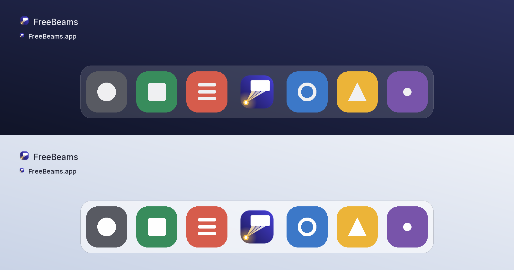
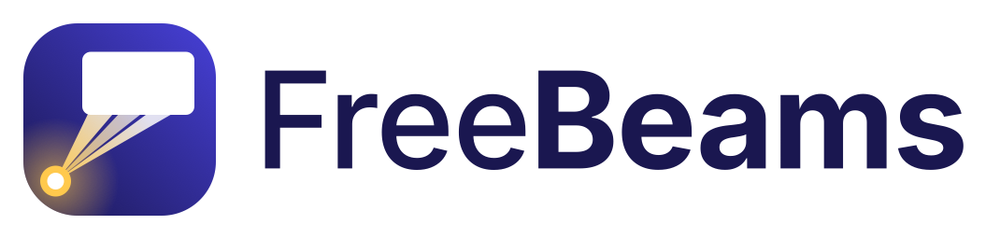

# FreeBeams brand guide

The visual identity of FreeBeams: the app icon, the wordmark, the palette and how the files are
regenerated. Everything here is original artwork for this project.



## 1. Concept

**Beams of light from a projector, lighting up a screen.** A small lens at the bottom-left of the tile
throws three beams up and to the right; where they land, a slide glows white. Nothing else: no cross, no
dove, no music note. The light is the identity, "Free" is the licence, and the slide is what a
congregation actually sees.

- One bold silhouette at 16 px (a bright rectangle, a light wedge, a gold dot) and real depth at 1024 px
  (the gradient tile, the glow of the lamp on the tile, three distinct beams).
- The beams run from **gold** at the lens to **white** at the slide, so beam and slide fuse into one
  bright shape when the icon is small and separate into light and screen when it is large.
- The composition is deliberately skewed: the lens sits left of the slide, the way a projector sits below
  and to the side of a screen, so the mark reads as a projector throwing light, not as a lamp hanging
  under a shade.

## 2. Palette

| Token | Hex | Used for |
|---|---|---|
| Indigo, deep | `#1A1750` | tile gradient (bottom-left); wordmark text on light backgrounds |
| Indigo, lit | `#4740D8` | tile gradient (top-right) |
| Beam gold | `#FFC94D` | lens, beams at the source, lamp glow |
| White | `#FFFFFF` | slide, lens core, beams where they land |
| Text on dark | `#F5F7FB` | wordmark text on dark backgrounds |
| Screen indigo, deep | `#12103A` | Logo screen gradient (bottom-left): the tile gradient at ~70 % brightness |
| Screen indigo, lit | `#322D98` | Logo screen gradient (top-right) |

Gradients run diagonally, deep at the bottom-left to lit at the top-right, so the tile itself is lit from
the side the beams go. The beams are `#FFC94D` at 95 % opacity at the lens fading to `#FFFFFF` at 85 % at
the slide; the middle beam is drawn at 85 % of that so the three stay distinct at large sizes. The lamp
glow is a radial gradient of beam gold from 60 % to 0 % over 270 canvas units around the lens. No filters,
masks or blurs: the SVG renders identically in QuickLook, browsers and Godot's ThorVG.

## 3. Construction

The master is **`graphics/icon.svg`**, a 1024 x 1024 canvas on Apple's macOS icon grid; a copy lives at
`freebeams/icon.svg`. All numbers are canvas units.

| Element | Geometry |
|---|---|
| Tile | 824 x 824 at (100, 100), corner radius 232 (the rounded-square template; Windows and Linux use the same PNG) |
| Lens | circle at (238, 776): gold r = 66, white core r = 36 |
| Glow | circle r = 270 at the lens, clipped to the tile |
| Beams | three triangles from the lens to the slide's bottom edge at y = 456, spanning x 392–511, 539–645 and 673–792 (28-unit gaps); their ends are hidden under the slide, which is why they stop at the height where the slide's corners start rounding |
| Slide | 480 x 270 (16:9) at (352, 222), corner radius 36, white |

The thinnest feature is the 28-unit gap between beams (half a pixel at 16 px, where it is meant to
disappear) and the 30-unit gold ring of the lens (0.5 px at 16 px, 2 px at 64 px). Everything that must
survive at 16 px is at least 66 units.

Do not add text, shadows or a border to the tile; do not recolour the beams; do not place the mark on a
busy photo. Where a monochrome mark is needed (a template, a favicon), use the slide + beams + lens in a
single colour on a flat tile.

## 4. Wordmark




`freebeams/wordmark-dark.svg` (light text, for dark backgrounds) and `freebeams/wordmark-light.svg`
(indigo text, for light backgrounds). The lockup is the icon at 128 px beside the name set in
**Inter** (SIL Open Font License 1.1): "Free" in Inter Medium, "Beams" in Inter Bold, 72 px (cap height
52 px, half the tile height), tracking -0.015 em, text starting 20 px right of the tile. The name is
**outlined to paths**, so the SVGs render the same everywhere without the font installed. Use one text
colour; a gold "Beams" works on dark but fails contrast on light, so it is not part of the system.

**Clear space.** Keep at least half the tile height (52 px at the lockup's 128 px) free around the
lockup. **Minimum size.** 24 px tall for the lockup (the tile alone goes down to 16 px).

## 5. Logo screen

`docs/branding/tools/build.py --logo-screen` writes a 1920 x 1080 PNG: the screen gradient
(`#12103A` to `#322D98`) with the dark wordmark centred at 136 px tall (568 px wide). It is the app's
built-in Logo screen (embedded as `internal/app/core/logo-screen.png`), what the congregation sees
before and after the service, so it is deliberately quiet.

## 6. Files

| Path | What |
|---|---|
| `graphics/icon.svg` | the master artwork |
| `graphics/icon.png`, `graphics/icon.ico`, `graphics/FreeBeams.icns` | the icon set the exports reference, rasterised from the master |
| `freebeams/icon.svg` | copy of the master |
| `freebeams/wordmark-dark.svg`, `freebeams/wordmark-light.svg` | the lockups (text outlined) |
| `freebeams/preview/icon-{16,32,64,128,256,512}.png` | the icon at the OS icon sizes |
| `freebeams/preview/wordmark-{dark,light}.png` | the lockups at 2x |
| `freebeams/preview/context.png` | the icon in a Dock row and a Finder row, on a dark and on a light desktop |
| `freebeams/explorations/*.svg`, `sheet.png` | the variants explored on the way to the mark (a wedge to the slide's far corners, a centred beam, three bare rays, beams spilling past the slide, a beam under the slide, a fading spill, the skewed cone that became the icon) |
| `tools/build.py` | regenerates everything under `freebeams/` and the Logo screen PNG |

## 7. Regenerating

Both scripts run on macOS and rasterise with QuickLook (`qlmanage`). QuickLook thumbnails are opaque, so
each SVG is rendered on white and on black and the alpha recovered per pixel; the scripts check that the
canvas corners come out fully transparent.

```bash
# The icon set (graphics/icon.png, icon.ico, FreeBeams.icns); needs Pillow and numpy.
packaging/icons/make-icons.sh

# The wordmarks, previews and the Logo screen; needs Pillow, numpy, fontTools and the Inter TTFs
# (any Inter 4.x: https://github.com/rsms/inter releases, Google Fonts, @expo-google-fonts/inter).
python3 -I docs/branding/tools/build.py --font-medium Inter-Medium.ttf --font-bold Inter-Bold.ttf \
    --logo-screen internal/app/core/logo-screen.png
```

Edit `graphics/icon.svg`, run both, commit the results. `project.godot` (`config/icon`,
`config/macos_native_icon`, `config/windows_native_icon`) and `export_presets.cfg` reference the files by
name, so nothing else changes.
